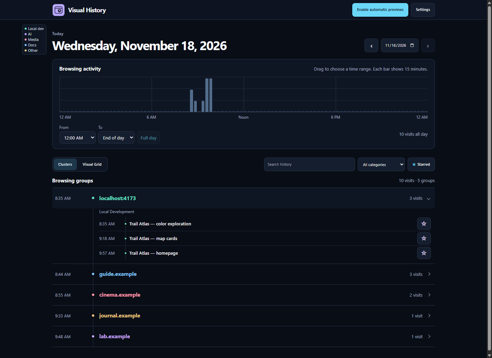
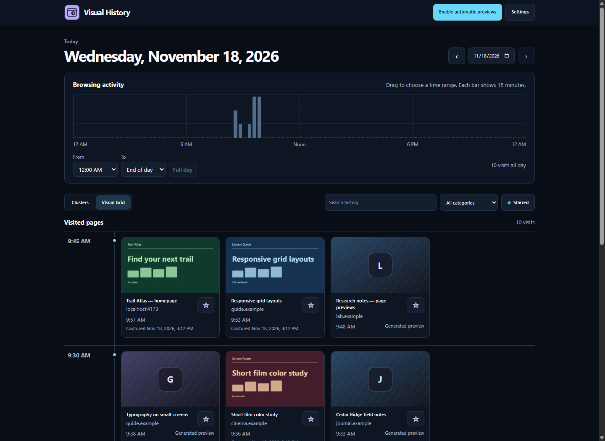

# Visual History

Visual History makes your Brave history easier to browse. Use the activity chart to pick a time range, then search, filter by category, or revisit starred pages. Your existing history is available as soon as you open it.

**Clusters** groups visits by site. Open a group to see when you visited and which pages you opened.

**Visual Grid** shows page previews along a vertical timeline. Pages without a saved screenshot get a preview tile.

Screenshots show example browsing history.

## Install in Brave

1. Download `visual-history-1.0.0.zip` from **Releases** and unzip it to a folder you can keep.
2. Open `brave://extensions`, turn on **Developer mode**, and choose **Load unpacked**. Select the folder you unzipped.
3. Open Brave’s History or use the **Open Visual History** toolbar button.

Tested on desktop Brave for Windows.

## Automatic previews

Choose **Enable automatic previews** and allow Brave’s request for access to websites. In **Settings**, you can pause previews, exclude sites, or clear thumbnails. Your history and previews stay on your device. See the [privacy policy](PRIVACY.md).

[MIT license](LICENSE)
